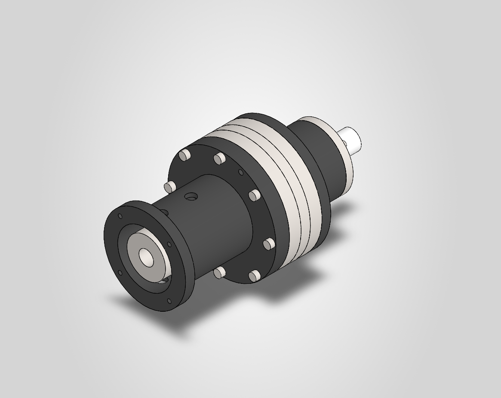
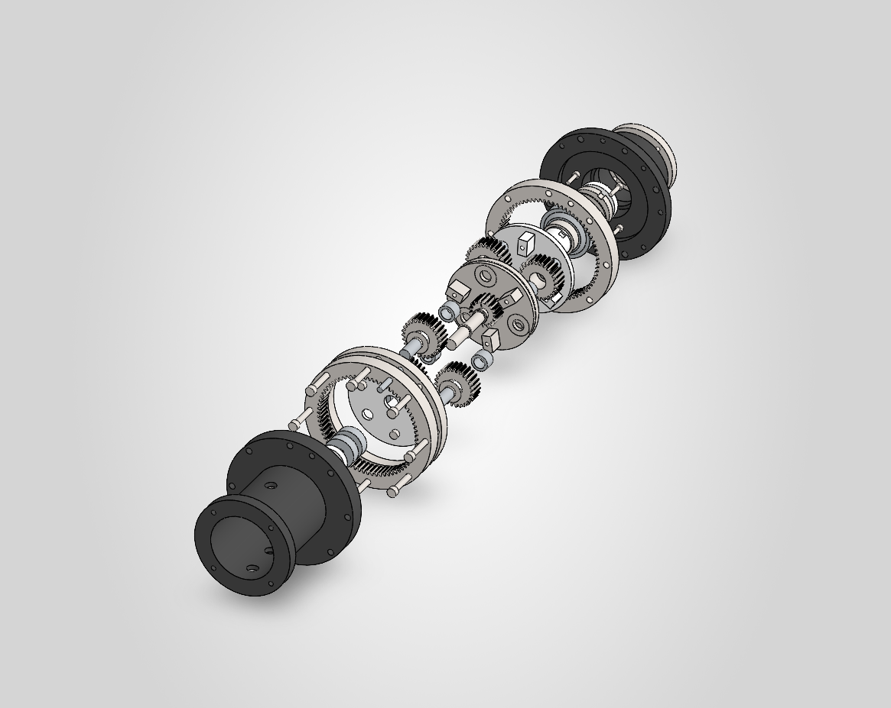
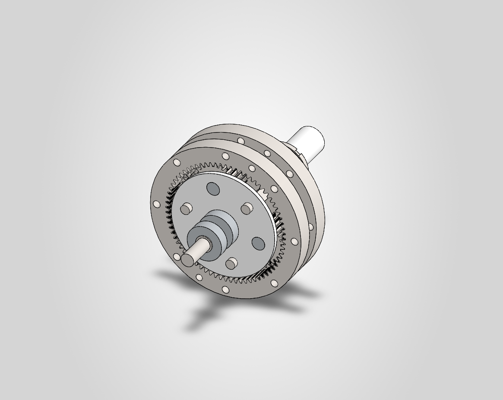
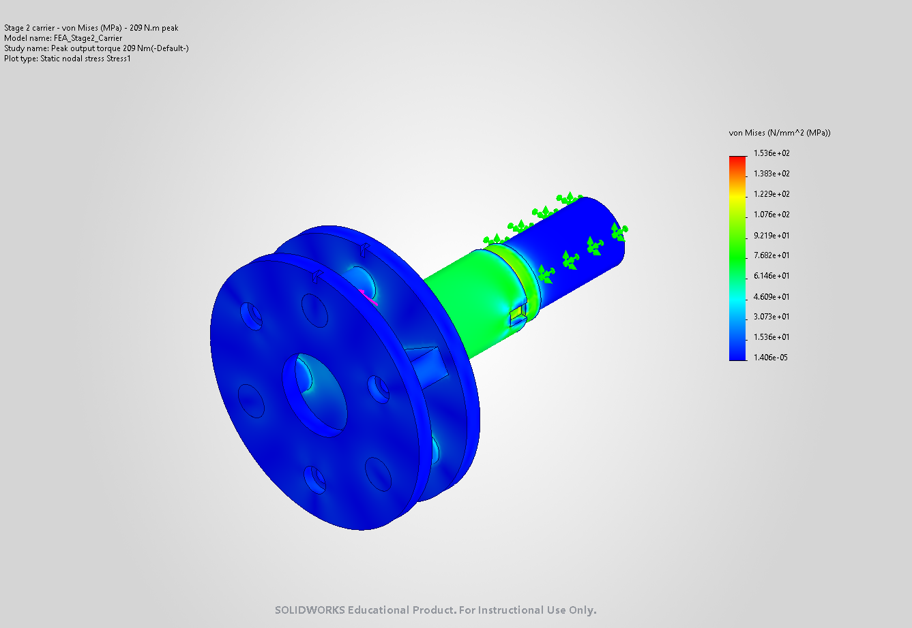
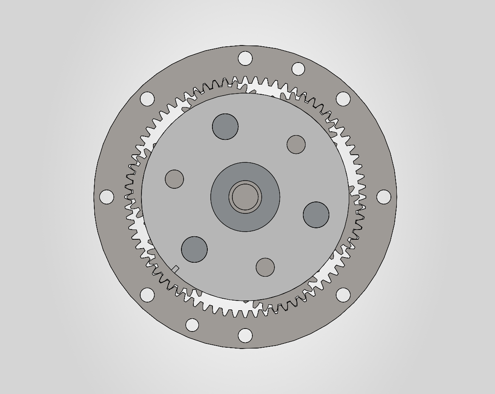

# 25:1 Two-Stage Servo Planetary Gearbox (PG25)

I designed a compact two-stage planetary gearbox for a 750 W servo motor, from the requirements to manufacturing drawings. The CAD model is complete, with hand calculations to ISO / DIN / VDI standards, 17 ISO GPS manufacturing drawings, FEA validation and a DFMA review.

<p align="center">
  
  
</p>

▶ **Mechanism video:** [`Renders/PG25_mechanism_16x9.mp4`](Renders/PG25_mechanism_16x9.mp4) · vertical 4:5 version: [`PG25_mechanism_4x5.mp4`](Renders/PG25_mechanism_4x5.mp4)

📄 **Full design rationale (equations, standards, 33 decisions):** [`Report/Design_Rationale.pdf`](Report/Design_Rationale.pdf)

---

## Key data

| | |
|---|---|
| Ratio | **25:1**, two identical 5:1 stages with fixed ring, sun input and carrier output |
| Gearing | 18 / 27 / 72 teeth, module 1.5, α = 20°, face width 15 mm, 3 planets per stage |
| Motor | Yaskawa SGM7J-08A, 750 W: 2.39 N·m rated, 8.36 N·m peak, 3000 rpm |
| Output torque | 59.8 N·m rated · **209 N·m peak** · 120 rpm |
| Rating | ≈ 90 N·m for 10 000 h (limited by the planet needle bearing, D-010) |
| External output loads | 3 kN radial + 1.5 kN axial; tapered roller bearings in O arrangement, L10h ≥ 23 000 h |
| Envelope | Ø140 mm housing × 175 mm, mounting face to motor face |
| Backlash | ≤ 9.9 arcmin worst case (4.6–8.9 arcmin statistical) |
| Efficiency | ≈ 0.96, temperature rise 28 K at the rated point |
| Mass | 10.3 kg (73 parts) |

## Engineering highlights

- **Gear steel chosen by calculation, not habit.** Through-hardened 42CrMo4 gave a pitting safety of S<sub>H</sub> = 1.07 on the sun gear, so it was rejected. Case-hardened 18CrNiMo7-6 with 5 µm helix crowning reaches S<sub>H</sub> = 1.67 (ISO 6336, method C face-load factor).
- **The bearing, not the teeth, sets the rating.** The teeth could carry twice the load. The limit is the drawn-cup needle bearing that fits inside a 40.5 mm planet.
- **The ring gears are the housing.** The Ø140 envelope leaves no room for a sleeve, so five sections (input housing, ring 1, spacer, ring 2 and output housing) are clamped by eight M6 tie bolts and located by two dowels. Slip safety at peak torque is 2.0 (VDI 2230).
- **Output shaft integral with the stage 2 carrier**, so there is no torque joint at 209 N·m. The bearing seats and pin bores are ground in one set-up.
- **Tolerancing from the bearing axis.** Every gear and bearing is located from the axis it turns on (ISO GPS datums). A backlash budget with ISO 1328 grade 6 and tooth-thickness allowances sets the backlash class.
- **FEA checks the hand calculations.** Three SOLIDWORKS Simulation studies cover the carrier, the output housing and the ring rim. The nominal stresses agree with the hand calculations, and every peak stays below yield at peak torque.
- **DFMA.** A Boothroyd–Dewhurst analysis identifies a series version with 73 → 51 parts and 607 → 480 s of manual assembly time.

<p align="center">
  
  
  
</p>

## Repository contents

```
Assemblies/        Top assembly, 5 subassemblies and Parts/ (33 part files)
Master_Layout/     Skeleton part with the governing dimensions and equations
Drawings/          17 manufacturing drawings: SOLIDWORKS .SLDDRW and PDF
Calculations/      Requirements sheet, design calculations (Python) and DFMA script
Simulation/        FEA models (stage 2 carrier, output housing, ring rim) and result plots
Report/            Design rationale (HTML + PDF) and DFMA / materials and processes workbook
Renders/           SOLIDWORKS captures and the mechanism video
Materials/         Custom material library (100Cr6 hardened)
References/        Master-layout equations
```

### Drawings

| No. | Part | No. | Part |
|---|---|---|---|
| [PG25-000](Drawings/PG25-000.pdf) | General assembly and BOM | [PG25-304](Drawings/PG25-304.pdf) | Planet pin, stage 2 |
| [PG25-101](Drawings/PG25-101.pdf) | Input shaft with sun 1 | [PG25-305](Drawings/PG25-305.pdf) | Output carrier with integral shaft |
| [PG25-201/302](Drawings/PG25-201_302.pdf) | Ring gear z72 (both stages) | [PG25-306](Drawings/PG25-306.pdf) | Carrier plate 2, input side |
| [PG25-202/303](Drawings/PG25-202_303.pdf) | Planet gear z27, crowned | [PG25-401](Drawings/PG25-401.pdf) | Cone spacer |
| [PG25-203](Drawings/PG25-203.pdf) | Planet pin, stage 1 | [PG25-501](Drawings/PG25-501.pdf) | Output housing |
| [PG25-204](Drawings/PG25-204.pdf) | Carrier plate 1, input side | [PG25-502](Drawings/PG25-502.pdf) | Interstage spacer ring |
| [PG25-205](Drawings/PG25-205.pdf) | Carrier plate 1, bridges + spline hub | [PG25-503](Drawings/PG25-503.pdf) | Input housing / motor adapter |
| [PG25-206](Drawings/PG25-206.pdf) | Planet thrust washer | [PG25-504](Drawings/PG25-504.pdf) | Output seal cover |
| [PG25-301](Drawings/PG25-301.pdf) | Sun 2 with DIN 5480 stub | | |

### Standards used

ISO 6336 (gear capacity) · ISO 1328 (gear accuracy) · ISO 281 (bearing life) · ISO 286 (fits) · ISO 1101 / 5459 / 8015 (GD&T, ISO GPS) · DIN 5480 (splines) · VDI 2230 (bolted joints) · DIN 3760 (shaft seals) · EN 10083 / EN 1563 (materials).

## Reproducing the calculations

```bash
python Calculations/02_design_calculations.py   # writes Calculations/02_design_results.json
python Calculations/03_dfma_materials.py        # writes Report/PG25_DFMA_Materials_Processes.xlsx (needs openpyxl)
python Report/make_rationale_pdf.py             # prints Report/Design_Rationale.html to PDF (Windows, Microsoft Edge)
```

The design calculations use only the Python standard library.

## Notes on the CAD files

- Made in **SOLIDWORKS 2026 (Student Edition)**. The files open in SOLIDWORKS 2026 or newer. A commercial licence shows them with an educational watermark.
- Open `Assemblies/Planetary_Gearbox_2_stage.SLDASM`. Two of its configurations:
  - `Default`: the full gearbox, with the exploded view.
  - `Interior_Turntable`: the gear train only, with housings and fasteners hidden.
- The tooth flanks are modelled with zero backlash. The drawings carry the tooth-thickness allowances.
- The FEA result databases are not included because they are large. Open a study in `Simulation/` and run it to regenerate the results.

## How it was made

Developed using Python (for reproducible calculations) and SOLIDWORKS—controlled via its API—with Claude Code serving as an AI assistant for generating drawings, documentation, and FEA analysis. I established the requirements and made or approved every design decision.

## License

- **Design files and documentation** (CAD models, drawings, reports, images and videos): [CC BY-NC 4.0](LICENSE). You may share and adapt them with attribution, for non-commercial purposes.
- **Source code** (`Calculations/*.py`, `Report/make_rationale_pdf.py`, `Drawings/_tools_SwHelper.cs`): [MIT](LICENSE-CODE).

© 2026 Alan Arzamendi
